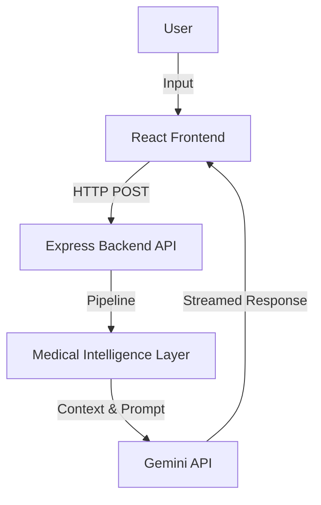
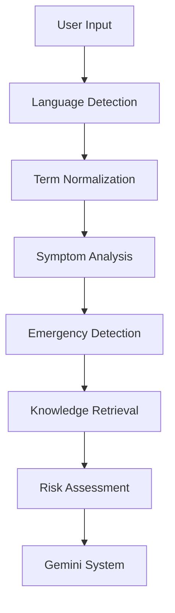

# Technical Architecture

## 1. System Architecture

## 2. Frontend Architecture
The frontend is built using React and TypeScript, structured as a Single Page Application (SPA).
- **Pages**: `ChatPage`, `HealthTipsPage`, `LandingPage`, `ProfilePage`, `SettingsPage`
- **Components**: `Layout`, `MessageBubble`, `EmergencyBanner`, `TypingIndicator`
- **State Management**: React `useState` and `useRef` for streaming chat UI.

## 3. Backend Architecture
The backend is an Express Node.js application (`server.ts`) that serves dual purposes:
- Serving the production static files.
- Exposing the `/api/chat` endpoint to handle the AI chat streaming logic.

## 4. Medical Intelligence Pipeline

## 5. Retrieval Pipeline
Implemented in `knowledgeRetriever.ts` and `semanticMatcher.ts`. It expands requested symptoms using synonym maps (e.g., *stomachache* -> *abdominal pain*). The augmented symptom list is scored against condition profiles in `medicalKnowledgeBase.ts` based on symptom counts and severity relevance. 

## 6. Risk Assessment Flow
Evaluates the combination of:
- Symptom count
- Severity Level (Low, Medium, High, Emergency)
- Historical Trends (Improving, Stable, Worsening)
Outputs a Risk Profile directly appended to the Doctor Context Framework to instruct Gemini on the tone and necessity of referring the user to a medical professional.
